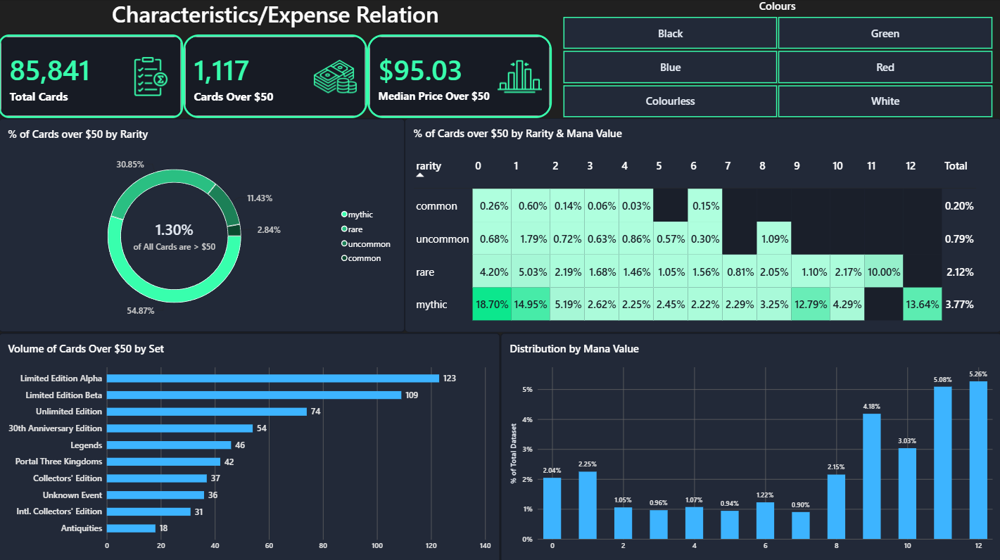

# Magic: The Gathering Characteristic/Price Analysis Overview
This analysis has been conducted to determine what characteristics are associated with expensive Magic: The Gathering cards. This project used a culmination of Python, pandas, MTGJSON data, and Power BI to investigate this question more in depth. If you are looking to access this analysis, a secondary README file has been added to the ```data/``` directory with instructions on how to proceed.



## What Characteristics Were Taken into Account?
There are potentially hundreds of characteristics that could be examined to determine the price of a card. From the finish on the card (foil/non-foil), the playablitily in different formats, or the tens of details related to each card such as the artist, release date, promotional only, etc. For this analysis I chose to look at card details as I felt like it was the most reliable way of determining the price of a card. More specifically I chose to look into these characteristics:
- ```Rarity``` (common, uncommon, rare, mythic. Not to be confused with how hard or infrequent a card is to find)
- ```Mana Value``` (a number value which determines when a card can be played during a game of Magic: The Gathering)
- ```Keywords / Abilities``` (the text printed on the card itself and what abilities it can do)
- ```Colour``` (Magic: The Gathering cards can have 5 distinct colours of White, Blue, Black, Red and Green along with a "Colourless" option)
- ```Types``` (there are 9 main card types in Magic: The Gathering: Land, Creature, Artifact, Enchantment, Planeswalker, Battle, Instant, Sorcery and Kindred)
- ```Set``` (each card is apart of a set which is a collection of cards that helps identify where a card is from and when it was released)

For a more fair examination, I restricted the primary analysis to printings with a non-foil version. This was done to reduce the influence of premium finishes such as foil and etched foil variations, which can command substantially greater prices for otherwise indentical card designs. Premium finishes were treated as a separate potential factor rather than mixed into the primary price analysis.

## Defining an Expensive Card
The term "expensive" is inherently extremely subjective. For one individual, $5 may be considered expensive whereas another individual may frequently purchase cards worth hundreds of dollars without thinking twice. For the purposes of this project, I defined an expensive Magic: The Gathering card as a printing with a TCGplayer normal price of $50 USD or more. The price snapshots used in this analysis were taken on September 24, 2026 for a majority of the printings and earlier dates for cards that are sold more scarcely.

I chose this threshold because $50 represents a meaningful amount of money for a single trading card from the perspective of the analysis. This is in no way intended to represent an official industry definition of an expensive card. Since this threshold is subjective as mentioned previously, I also examined alternative thresholds where appropriate to give a better picture.

## Data Source and Preparation
The data for this analysis comes from MTGJSON (https://www.mtgjson.com/downloads/all-files/), using the AllPrintings.json and AllPrices.json datasets.

To process and prepare the data, a mix of Python and pandas was used to extract card characteristics and price information as well as combine the datasets into a single table for analysis.

The detailed preparation process:
1. Loaded the JSON data and first extracted the characteristics I would be examining from the printing data which includes the aforementioned topics (rarity, mana value, colour, etc.)
2. Following that was extracting the price data and specifically looking at the TCGplayer, retail, normal pricing of cards as well as the most recent price snapshot at the time of this step
3. Formatting both as pandas DataFrames and merging them into one total dataset
4. Quick analysis of the dataset to make sure all values appear as they should as well as some clean up to prepare tables for use in Power BI
5. Generating and exporting the resulting main dataset along with a helper keyword dataset for improved examination to CSV for analysis in Power BI

The final dataset contains one row per printing with a matching price record.

## Key Findings
While each of the characteristics I examined all came together to help determine how the monitary value of a card is assessed, there were a few key sections that stood out the most:

- ```Rarity``` - When first looking at the rarity section it can be noted that the mythic rarity has the highest percentage of expensive ($50+) cards, followed by rare, uncommon and common which, fundamentally, makes sense as it follows the rarity pipeline. However, when you examine the data a little closer you would notice that rare cards actually have a higher median price of cards $50 or more, sitting at $109.17 whereas mythic cards only sit at a median of around $72.54. To that point, there are 30,079 rare cards printed and 638 of them are $50 or more (2.12%) but there are only 6,627 mythic cards printed with 250 of them at $50 or more (3.77%), as well as there is some information that is difficult to tell through data alone but the mythic rarity was not introduced until 2008, yet Magic: The Gathering has been around since 1993. This can be seen through the set chart as well, when you want to examine mythic cards, virtually all of the top 10 sets with a high amount of $50+ cards do not include any mythics as they did not exist at that time.
- ```Set``` - In terms of how the set relates to price, after doing a bit of investigating it should be known that other than Unknown Event and 30th Anniversary Edition which are non-playable play test cards and a special reprint set of the first sets respectively, the most recent set came out in 1999. Sets like Limited Edition Alpha (1993), Limited Edition Beta (1993), Unlimited Edition (1993) were the first sets to be printed in Magic: The Gathering history and as such have a major collectibility to them with an example being Limited Edition Alpha. The set contains 198 cards in total with 123 of those cards being worth $50 or more and of those cards, a median price of $110.00. So in terms of set/price relation it mainly comes down to either the age of the set or how collectible the cards within the set are.
- ```Mana Value``` - Mana value is another interesting section. From the chart alone you would be led to believe that the higher the mana value, the higher the price but in reality it is the exact opposite. It falls under the same category where the higher mana value cards have less printings but a portion of those cards are $50 or greater so it raises it's percentage. Overall, there are 10,778 printings with a mana value of 0, 220 of them being worth $50+ and a median price of $199.11, and as the mana value raises, the price and amount of expensive card almost always drops (ex. mana value:3 $50+:177 median:$85.43, mana value:9 $50+:13 median:$64.16).
- ```Keywords / Abilities``` - Now this topic was not able to be covered on the dashboard but it is still an important part of the analysis. First, I looked at cards with keywords to see the spread of top values as well as which ones have the higher percentage of $50+ printings. It can be noted again that when there are cards with very few printings but are worth a lot of money, their percentages are raised quite high but are not as comparable to cards with something like 20 or more printings. Switching then over to cards without keywords but ability or rules text as well as cards with no text, it turns out cards without keywords but rules text are actually more plentiful with over 2 times more printings worth $50 or more. It does get a bit more difficult when trying to look at the specific cards in this situation as at least cards with keywords share those keyword names with each other whereas cards with just rules text could have anything printed on them and don't have to share exact same lines of text. There are also cards with no text on them but once again they fall under the category of having an already small pool of cards to pick from and therefore have a higher percentage of expensive printings when in reality they are quite scarce.

## Limitations
Of course, as much as this project was aimed to create as accurate of an analysis as possible, there were a few limitations that cannot be overlooked:

- ```Price Changes Before/After Snapshot``` - As the price snapshot of cards for the data was taken on September 24, 2026, the analysis is only looking at prices in that current moment in time. Prices could have previously just spiked as a new set was coming out and prices tend to be inflated in the first couple of weeks as well as card prices could be rising or falling by the time you are reading this section currently.
- ```Printing versus Card Design``` - Cards can be reprinted into different sets and therefore have a new record and identity while mechanically being the exact same card. They are still important to look at because each has it's own pricing but similar to the foil/non-foil argument, there is no gameplay difference between cards in this category.
- ```Foil/Non-foil``` - As mentioned previously in this report, while foil/etched foil/non-foil variants all play a part in the price of a card, for this specific analysis I chose to look only at non-foil printings to reduce the influence of premium finishes and to keep the data a bit more cohesive. Different finishes could almost be a separate analysis on it's own.
- ```Not All Prices Listed``` - For a small group of cards in the data I pulled from MTGJSON, they did not have any actively listed prices whether that be because of the age of the card/set the card is from or the scarcity of limited edition printings. This does not cause a huge problem for the dataset but it is a limitation nonetheless.
- ```Extreme Values``` - some characteristics, not limited to just price, can have extreme values that can affect visualizations and summary statistics. For example, cards usually have mana values between 0 and 12 but there are outlliers (ex. a real card that was printed as a joke with a mana value of 1 million) that do have to be taken into account when analyzing the data or omitted to keep the analysis coherent.
- ```Association versus Causation``` - Though this analysis was created to see which characteristics correlated to expense, one characteristic generally does not dictate price alone. Take the relationship between rarity and price for example. Although the rarity of a card can definitely affect the price of a card, it does not prove that rarity alone causes a card to be expensive.
- ```Scarcity and Collectibility``` - It is hard to capture everything in a dataset. Things like demand for cards in certain gameplay formats, the condition of the card (lightly played, near mint, damaged, etc.) and overall collector interest all affect card pricing and are difficult to keep track of all at once.

## Conclusion
In conclusion, from the analysis I was able to perform using the desired characteristics the price of a Magic: The Gathering card can be derived from multiple cases. An "expensive" card tends to be the following: a mythic or rare, a mana value between 0 and 6, has no keywords but does have rules text, primarily colourless, is either a creature, artifact or land card and is from either an older set or a highly collectible set. Now this is not to say this is a guarantee or a normal occurance but it tends to be on average a similar outcome. There are many cards that don't follow these exact cases that are still worth a large sum of money as well as there are many more characteristics that can be taken into account that affect the price of a card, however, overall based on this analysis this is the conclusion I have come to.